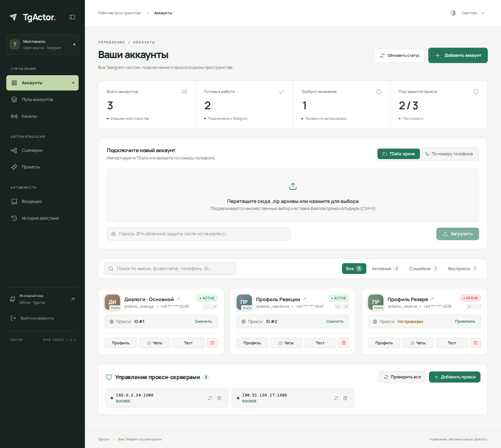
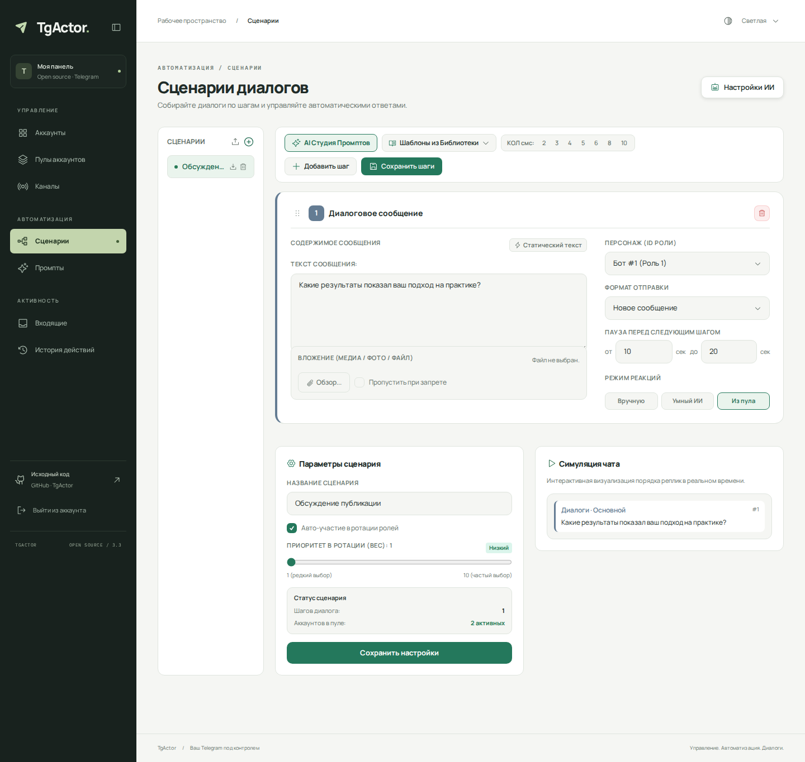
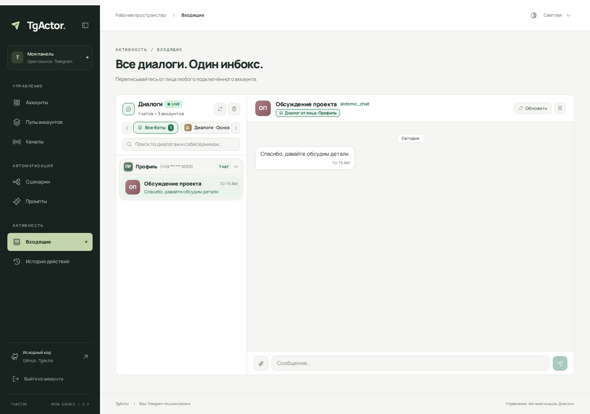
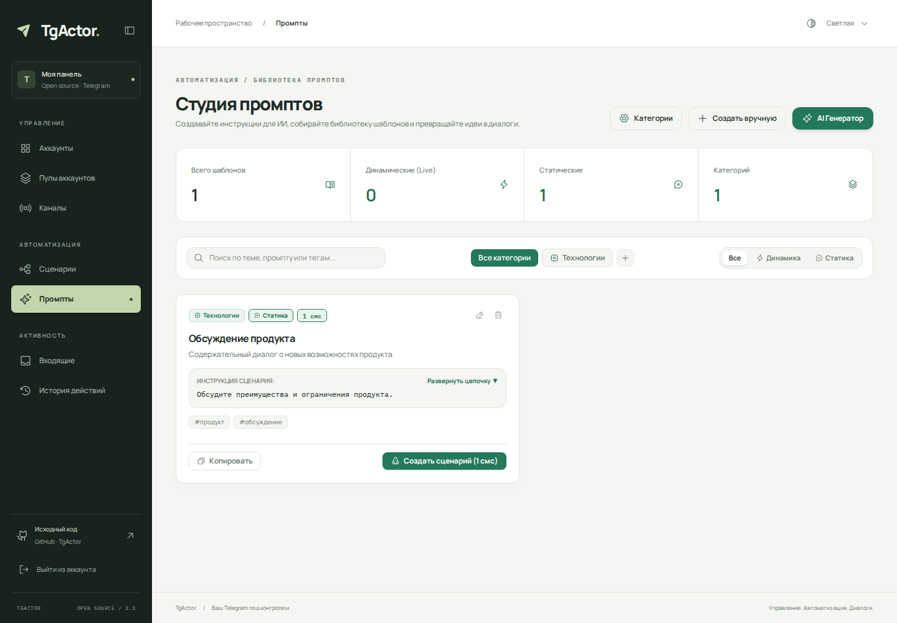
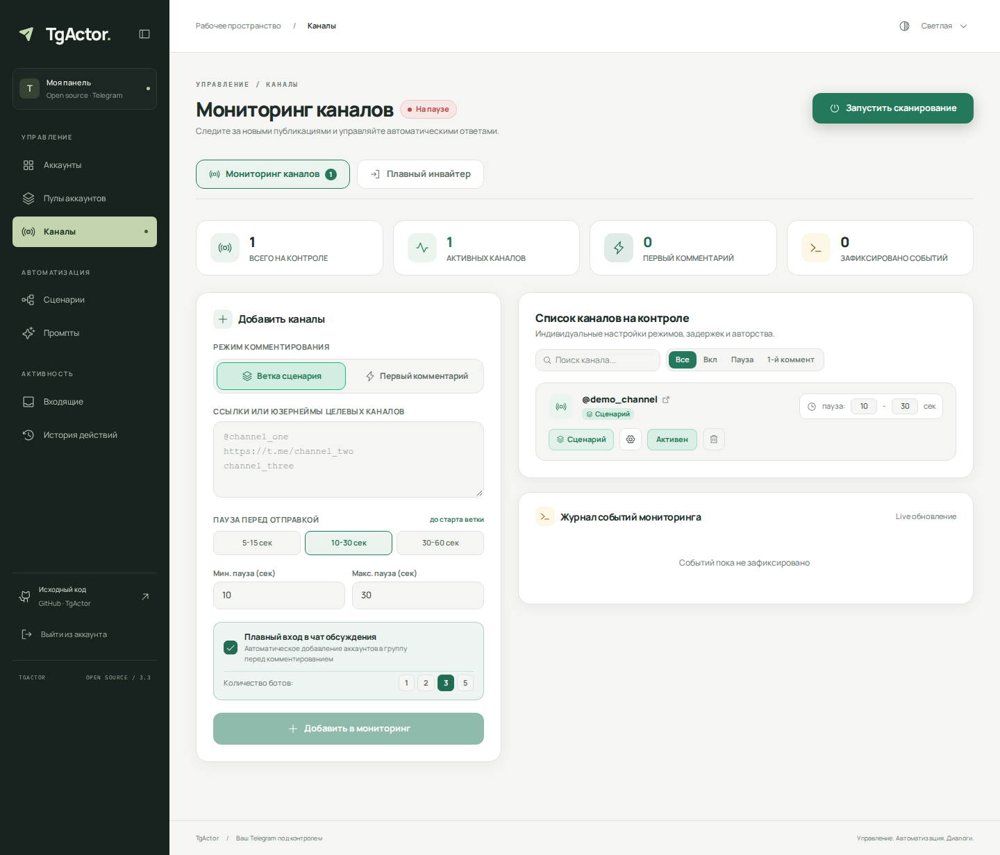
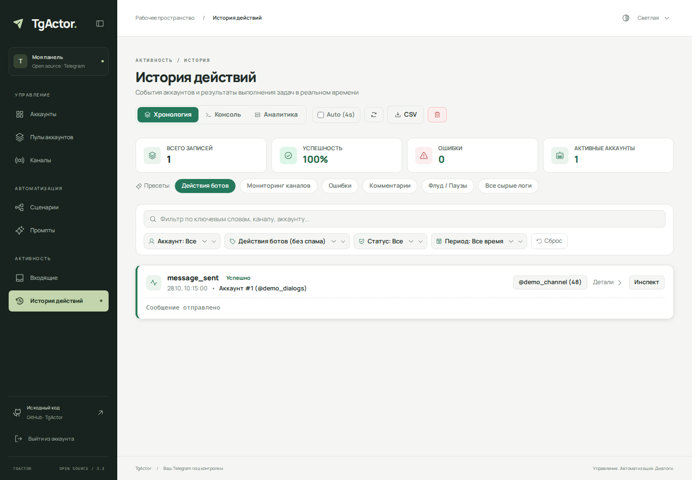
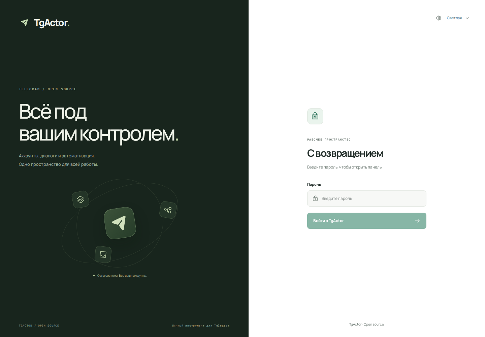
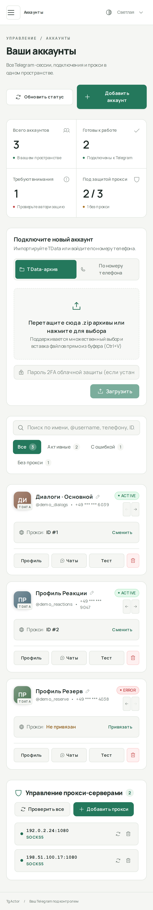

# Интерфейс TgActor

Скриншоты новой версии панели. Все профили, номера, адреса прокси и переписки здесь демонстрационные. Реальные данные установки для съёмки не используются.

## Аккаунты

Импорт TData и авторизация по номеру телефона, статусы сессий и прокси.

## Сценарии

Редактор сообщений с ролями, задержками и симуляцией диалога.

## Входящие

Диалоги нескольких аккаунтов и выбранная переписка.

## Промпты

Библиотека шаблонов и инструкции для генерации.

## Каналы

Управление мониторингом и параметрами обработки публикаций.

## История

События, фильтры и результаты операций.

## Вход

Пароль задаётся локальной конфигурацией и не показан на скриншоте.

## На телефоне

Скриншоты воспроизводятся браузерными тестами: `CAPTURE_UI=1 npm test` из каталога `frontend`. Они создаются в `frontend/test-results`; проверенные изображения для документации хранятся в этом каталоге `frontend` рядом с галереей.
